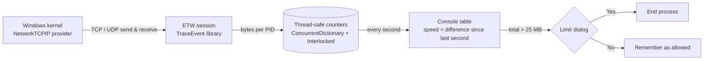

# 📡 İnternet Harcama 3

**A live per-process network monitor for Windows, with a data-limit guard.**

See which programs are using your internet right now, how fast, and how much data each one has used. When a program goes over the limit, the tool asks whether to shut it down. It reads traffic straight from the Windows kernel through **ETW (Event Tracing for Windows)**, so it needs no packet-capture driver and adds almost no overhead.

https://github.com/user-attachments/assets/6401913b-f1dd-450f-af7c-4363478790a7

---

## What you see

The console refreshes every second and lists the 20 processes that have used the most data:

| Column | Meaning |
|---|---|
| **PID** | Process ID |
| **Süreç Adı** | Process name |
| **İndirme** | Current download speed (B/s, KB/s, MB/s) |
| **Yükleme** | Current upload speed |
| **Toplam** | Total data used since the monitor started |
| **Durum** | `Aktif` (running), `Aktif (İzinli)` (over the limit but allowed by you), `[KAPATILDI]` (shut down) |

The interface text is in Turkish.

## Highlights

- **Kernel-level accuracy.** TCP and UDP send/receive events come from the kernel's `NetworkTCPIP` provider, attributed to the process that made them.
- **Data-limit guard.** When a process passes **25 MB**, an always-on-top dialog asks whether to end it. *Yes* ends the process; *No* marks it as allowed so you're not asked again.
- **Safety rails.** System-critical processes (`svchost`, `csrss`, `lsass`, `winlogon`, `explorer`, `dwm` and others) and the monitor itself are never offered for shutdown.
- **No frozen console.** Windows pauses a console app when you click inside its window ("QuickEdit" mode). Version 3 turns that off at startup, so the live view never stalls.
- **One-click start.** The app checks its own rights and relaunches itself through UAC if it isn't running as administrator, which kernel tracing requires.
- **ClickOnce publishing** for easy installation on other machines.

## How it works

1. **Elevation.** Kernel ETW sessions need administrator rights. The program checks its own token and, if needed, restarts itself with the `runas` verb so Windows shows the UAC prompt.
2. **Tracing.** A background task opens a `TraceEventSession`, enables the kernel network provider and adds every packet's size to a per-process counter.
3. **Thread-safe counting.** The ETW callback thread and the UI thread share data through `ConcurrentDictionary` and `Interlocked.Add`, so the hot path needs no locks.
4. **Speeds.** Once a second the UI loop compares each counter with its previous value; the difference is the speed for that second.
5. **Flicker-free drawing.** The table is redrawn in place with `Console.SetCursorPosition` instead of clearing the screen, and process names are cached per PID.
6. **The guard.** Processes over the limit are checked against the critical list, then a native Win32 `MessageBox` (called through P/Invoke) asks the user on a separate task, so the live view keeps updating while the dialog is open. Separate sets track processes that were shut down, are waiting for an answer, or were allowed, which prevents duplicate dialogs.

## Build & run

Requirements: Windows 10/11, Visual Studio 2022 with the *.NET desktop development* workload, .NET Framework 4.8.

1. Clone the repository and open `internetHarcama3.sln`.
2. Build once; Visual Studio restores the NuGet packages (TraceEvent and its dependencies) automatically.
3. Run. Accept the UAC prompt; the monitor opens in a new console window.

> The ClickOnce signing certificate is not included in the repository. If the build complains about it, open **Project Properties → Signing** and either untick *Sign the ClickOnce manifests* or create a new test certificate there.

## Version history

- **v3** (this version): data-limit guard with shutdown dialog, critical-process protection, status column, QuickEdit fix, ClickOnce publishing
- **Earlier version**: the live per-process monitor without the guard (see the commit history)

## Roadmap

- [ ] Make the limit configurable instead of a constant in the code
- [ ] Count IPv6 traffic as well
- [ ] End processes directly through the .NET `Process` API
- [ ] Export a session to CSV
- [ ] A small WPF window with live graphs
